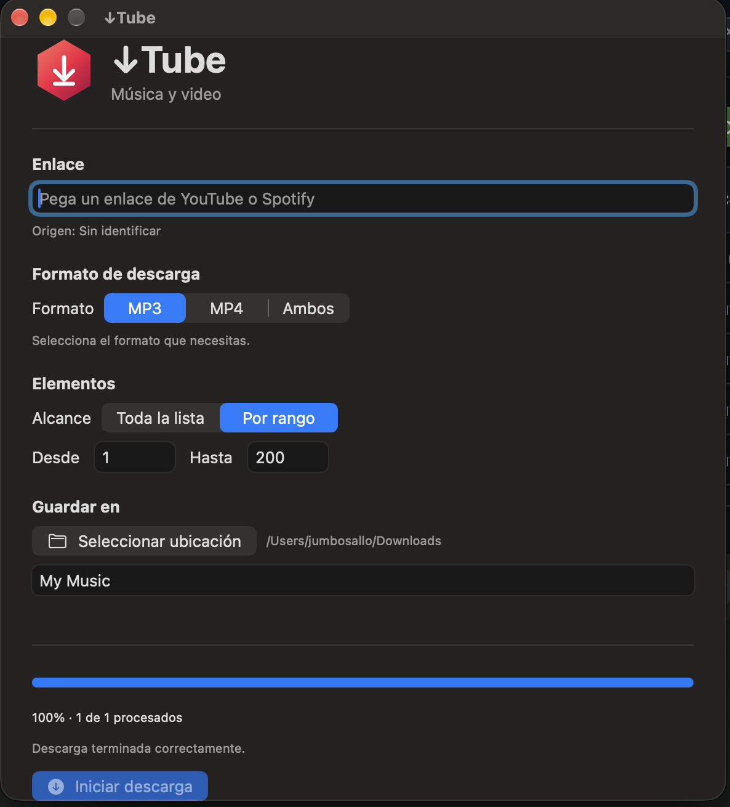

# ↓Tube para macOS

### Descargador multimedia nativo para macOS

↓Tube es una aplicación para macOS desarrollada con SwiftUI que permite descargar, convertir y organizar audio y video de YouTube, además de buscar contenido correspondiente a canciones y listas de reproducción de Spotify.

Funciona mediante **yt-dlp, spotDL y FFmpeg**.

**Versión 1.0 | Código abierto | Licencia MIT**

🌐 [Read in English](README.md)



## Características

- **Descargas MP3:** extracción y conversión de audio.
- **Descargas MP4:** videos reales convertidos a H.264/AAC.
- **YouTube:** videos individuales y listas de reproducción.
- **Spotify:** integración con canciones y playlists.
- **Descargas por rangos:** permite elegir posiciones específicas dentro de una lista.
- **Carátulas y metadatos:** incorporación de información musical cuando está disponible.
- **Detección de archivos existentes:** evita repetir determinadas descargas completadas.
- **Carpetas personalizadas:** selección de ubicación y nombre.
- **Indicador flotante:** hexágono animado con progreso general.
- **Cancelación:** permite detener una operación desde la aplicación.
- **Registro de ejecución:** información sobre errores y procesamiento.

## Indicador flotante

↓Tube incluye un indicador hexagonal animado que aparece durante las descargas y muestra el porcentaje general de elementos procesados.

Se puede arrastrar libremente por la pantalla. Incorpora efectos de movimiento, inercia y rebote.


## Requisitos

- Mac con Apple Silicon (M1, M2, M3, M4 o posterior).
- macOS 27.0.1 o posterior.
- Versión compatible de Xcode 27.
- Homebrew.
- yt-dlp.
- FFmpeg.
- pipx y spotDL.

La versión actual utiliza rutas de Homebrew para Apple Silicon. No se ha comprobado su funcionamiento en equipos Mac con procesadores Intel.

## Instalación

### 1. Instalar Homebrew

Si no lo tienes instalado, visita:

https://brew.sh

Sigue las instrucciones oficiales.

### 2. Instalar las dependencias

Abre Terminal y ejecuta:

```bash
brew install yt-dlp ffmpeg pipx
pipx ensurepath
pipx install spotdl
```

### 3. Descargar el proyecto

En GitHub, pulsa el botón verde **Code** y selecciona **Download ZIP**.

Descomprime el archivo descargado.

### 4. Abrirlo con Xcode

Abre `↓Tube.xcodeproj`.

Selecciona el destino **My Mac** y ejecuta el proyecto con:

`Command + R`

### 5. Utilizar ↓Tube

1. Copia un enlace compatible de YouTube o Spotify.
2. Pégalo en la aplicación.
3. Selecciona MP3, MP4 o ambos.
4. Escoge la lista completa o un rango.
5. Selecciona la ubicación de destino.
6. Escribe el nombre de la carpeta.
7. Pulsa **Iniciar descarga**.

El indicador flotante aparecerá durante el procesamiento.

## Organización de archivos

Los resultados se organizan en carpetas:

```text
Carpeta seleccionada/
├── MP3/
├── MP4/
└── Registro/
    └── ultima_ejecucion.log
```

## Compatibilidad de video

Los archivos MP4 se convierten utilizando:

- Video: H.264
- Audio: AAC
- Resolución: 640 × 360
- Formato de píxeles: yuv420p

Esta configuración busca mejorar la compatibilidad con reproductores y equipos multimedia antiguos, aunque el resultado depende de cada dispositivo.

## Integración con Spotify

↓Tube utiliza los enlaces de Spotify para identificar canciones y listas de reproducción.

Después busca contenido multimedia correspondiente en YouTube.

Cuando se solicita MP4, prioriza resultados que parecen videoclips oficiales y puede utilizar alternativas cuando no encuentra una coincidencia adecuada.

La identificación es automatizada y puede producir coincidencias incorrectas.

La aplicación no extrae directamente el audio protegido de Spotify.

## Tecnologías

- Swift
- SwiftUI
- AppKit
- yt-dlp
- spotDL
- FFmpeg

El proyecto fue desarrollado con asistencia de inteligencia artificial y probado localmente en un Mac con Apple Silicon.

## Estado del proyecto

**Versión 1.0 — Primera publicación del código fuente.**

Se han probado localmente las funciones principales de descarga MP3 y MP4 con enlaces de YouTube y Spotify.

El repositorio contiene el código fuente. Todavía no se distribuye como instalador de macOS firmado y listo para utilizar.

## Aviso legal

↓Tube es un proyecto independiente y no oficial.

No está afiliado, patrocinado ni respaldado por YouTube, Spotify, Google ni sus respectivos propietarios.

Cada usuario es responsable de cumplir las leyes de derechos de autor y las condiciones de las plataformas.

Descarga únicamente contenido que tengas autorización para utilizar.

## Licencia

Distribuido bajo la **licencia MIT**.

Consulta el archivo [LICENSE](LICENSE).

## Apoya el proyecto

Si ↓Tube te resulta útil, puedes dejar una estrella en GitHub.

Las sugerencias, reportes de errores y contribuciones son bienvenidos.
