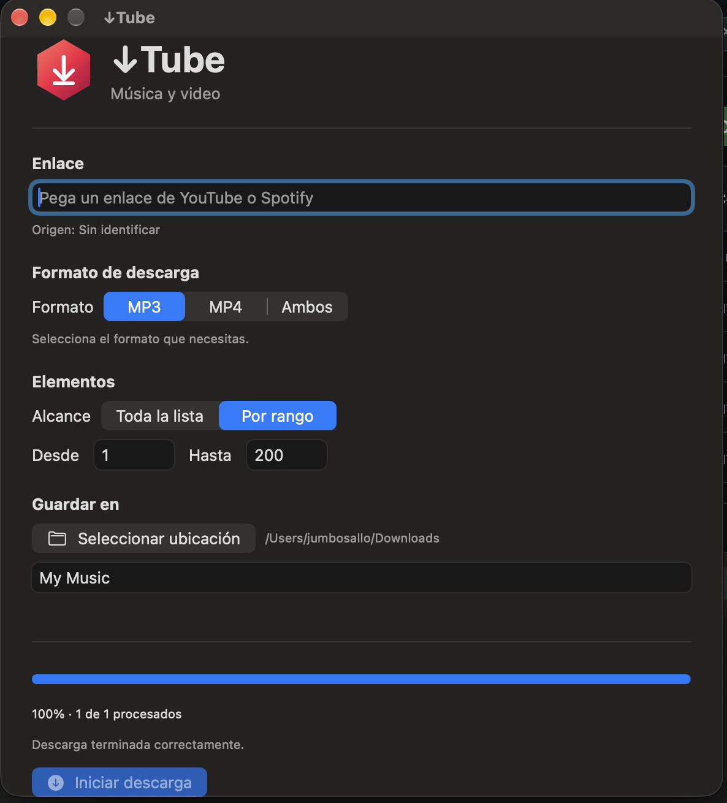

# ↓Tube for macOS

### A native media downloader for macOS

A lightweight macOS application built with SwiftUI that makes it easy to download, convert, and organize audio and video from YouTube and find matching YouTube content for Spotify tracks and playlists.

Powered by **yt-dlp, spotDL, and FFmpeg**.

**Version 1.0 | Open Source | MIT License**



## Features

- **MP3 downloads:** Extract audio and save it as MP3.
- **MP4 downloads:** Download videos and convert them to H.264/AAC.
- **YouTube support:** Process individual videos and playlists.
- **Spotify integration:** Find matching media for tracks and playlists.
- **Playlist ranges:** Download an entire playlist or select a specific range.
- **Audio metadata:** Add track information and artwork when available.
- **Smart downloads:** Skip previously completed files when detected.
- **Custom folders:** Choose where downloads are stored.
- **Floating progress:** Monitor download progress with an animated hexagonal indicator.
- **Cancellation:** Stop an ongoing download operation.

## Floating Progress Indicator

↓Tube includes a compact, draggable floating progress indicator that stays visible while downloads are running.

The hexagonal design displays the overall processing percentage and expands when the pointer hovers over it.


## System Requirements

- Apple Silicon Mac (M1, M2, M3, M4 or newer)
- macOS 27.0.1 or later
- Compatible Xcode 27 installation
- Homebrew
- yt-dlp
- FFmpeg
- pipx
- spotDL

**Note:** The current implementation uses Apple Silicon Homebrew paths. Intel Mac support has not been tested.

## Installation

### 1. Install Homebrew

If Homebrew is not installed, visit:

https://brew.sh

Follow the official installation instructions.

### 2. Install dependencies

Open Terminal and run:

```bash
brew install yt-dlp ffmpeg pipx
pipx ensurepath
pipx install spotdl
```

### 3. Download the source code

Click the green **Code** button in this repository and select **Download ZIP**.

Extract the downloaded archive.

### 4. Open in Xcode

Open `↓Tube.xcodeproj` in Xcode.

Select the **↓Tube** target and **My Mac** as the destination.

Build and run the project using:

`Command + R`

### 5. Start downloading

1. Paste a supported YouTube or Spotify URL.
2. Select MP3, MP4, or both.
3. Choose the complete playlist or a specific range.
4. Select a destination folder.
5. Click **Start Download** (shown as *Iniciar descarga* in the current Spanish interface).

The floating progress indicator appears during processing.

## Output Structure

Downloaded files are organized into folders:

```text
Selected Folder/
├── MP3/
├── MP4/
└── Registro/
    └── ultima_ejecucion.log
```

The log helps identify download and conversion errors.

## Video Compatibility

Videos are converted to MP4 with:

- Video codec: H.264
- Audio codec: AAC
- Resolution: 640 × 360
- Pixel format: yuv420p

This profile is designed with compatibility in mind, including older multimedia devices.

Actual compatibility depends on the hardware and is not guaranteed.

## How Spotify Integration Works

↓Tube uses Spotify links to identify songs and playlists.

The application searches for corresponding media from YouTube and processes the selected results.

When MP4 is requested, it prioritizes official-looking music videos and may use alternative versions when an exact match is unavailable.

Matching is automated and may occasionally select an incorrect or alternative version.

↓Tube does not directly extract Spotify's protected audio streams.

## Development

**Technology stack:**

- Swift
- SwiftUI
- AppKit
- yt-dlp
- spotDL
- FFmpeg

The application was developed with AI-assisted programming and tested on an Apple Silicon Mac.

## Project Status

**Version 1.0 — Initial public source release**

Core functionality has been tested locally with YouTube and Spotify links in MP3 and MP4 formats.

This repository provides source code. It is not yet a packaged, signed macOS installer.

## Legal Notice

↓Tube is an independent, unofficial project.

It is not affiliated with, endorsed by, or sponsored by YouTube, Spotify, Google, or their respective owners.

Users are responsible for complying with copyright laws and the terms of the services they use.

Only download content you have permission to access and use.

## License

This project is distributed under the **MIT License**.

See [LICENSE](LICENSE) for details.

## Support the Project

If you find ↓Tube useful, consider giving this repository a star on GitHub.

Stars help other developers discover the project.

Feedback, bug reports, and contributions are welcome.
